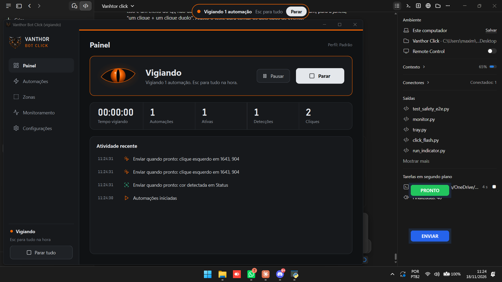
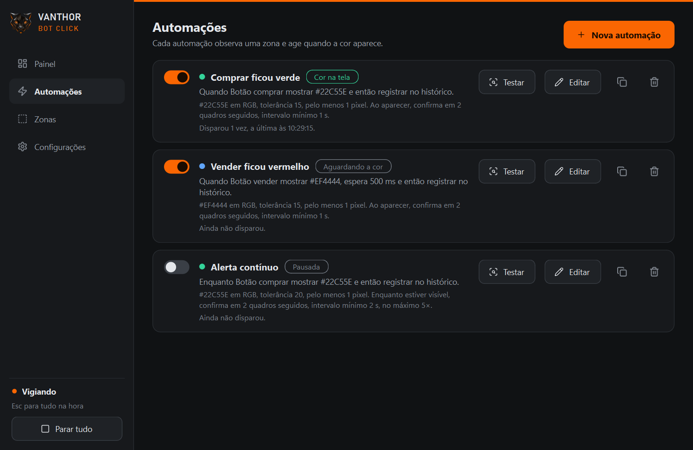
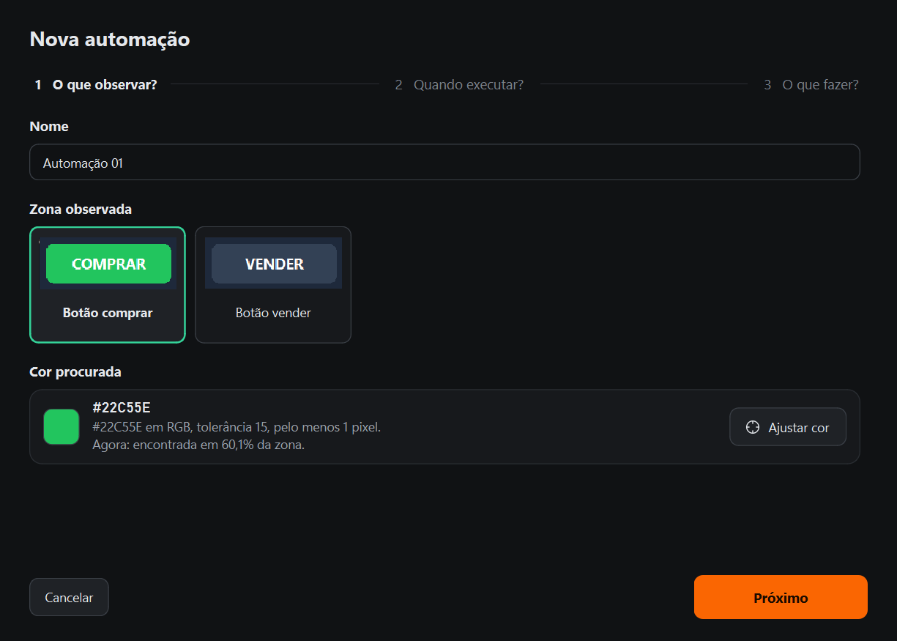
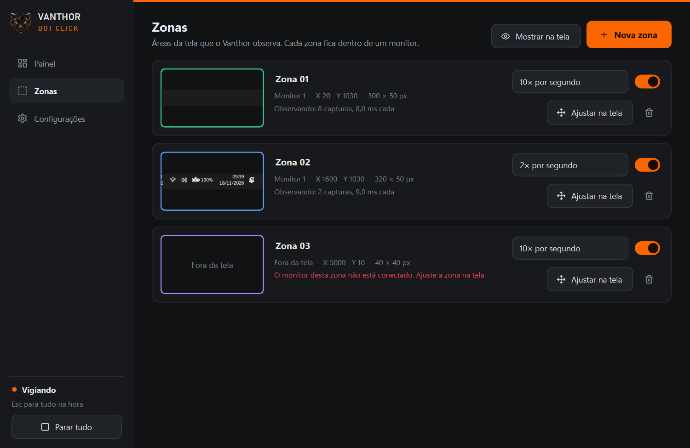
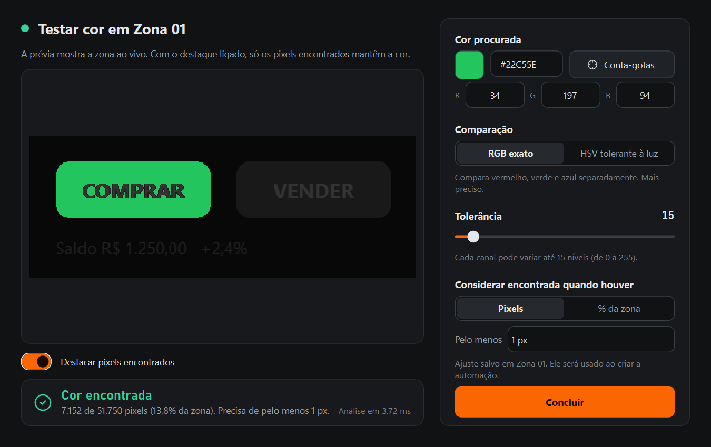
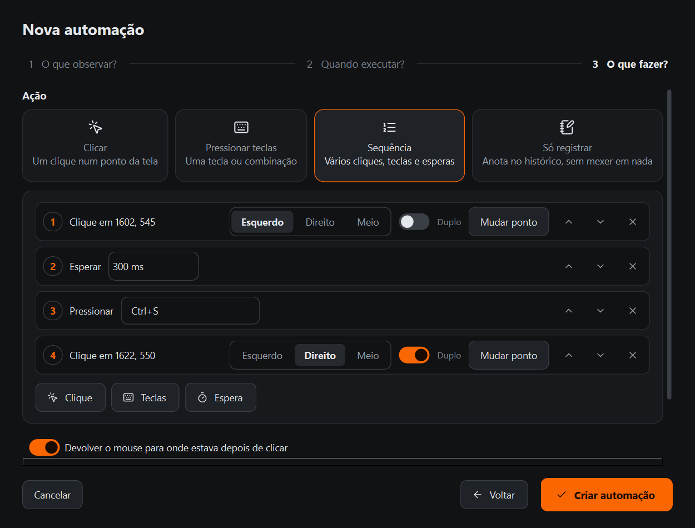
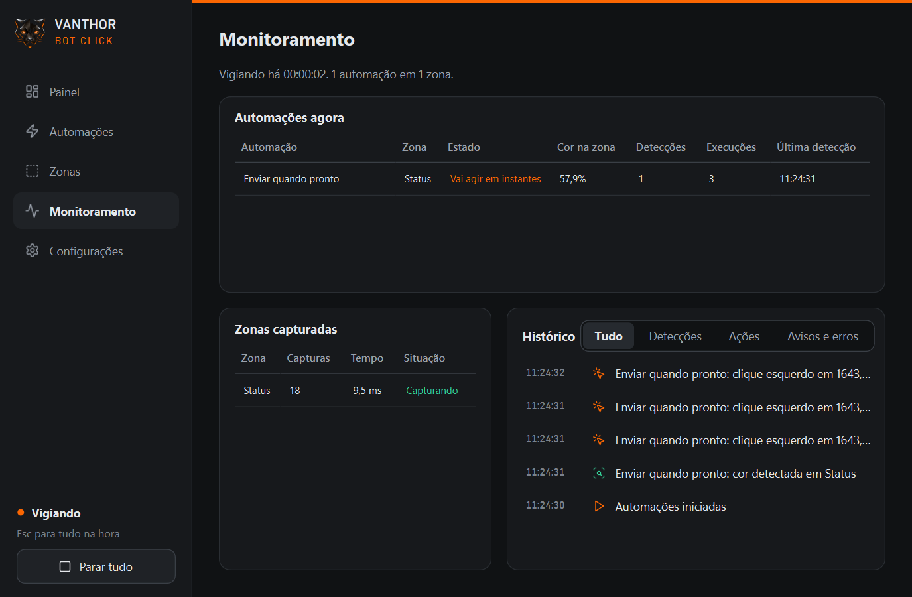
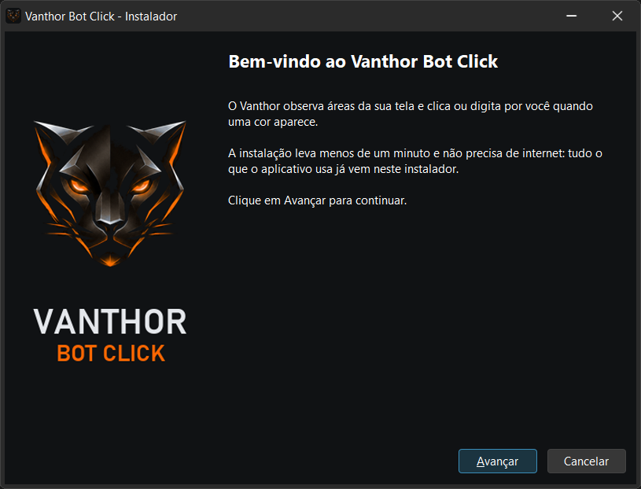
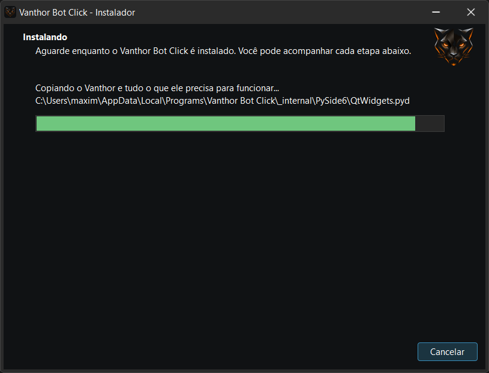
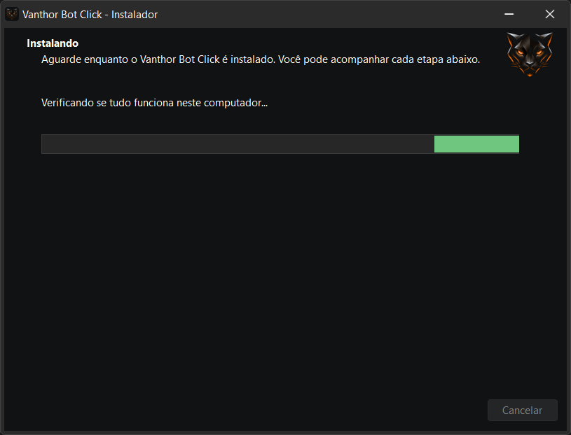

<p align="center">
  
</p>

<h1 align="center">Vanthor Bot Click</h1>

<p align="center">
  Automação visual para Windows: marque uma área da tela, escolha uma cor e o Vanthor clica ou digita por você quando ela aparecer.
</p>

<p align="center">
  <a href="https://github.com/JeovaneVenic/Vanthor-Click/raw/main/Instalador/VanthorBotClick-Setup-1.0.0.exe"><b>⬇ Baixar o instalador (v1.0.0, 26 MB)</b></a>
  &nbsp;·&nbsp; Windows 10 (2004+) e 11, 64 bits &nbsp;·&nbsp; 100% local, sem internet
</p>

---

## O que ele faz
O Vanthor vigia **zonas** da tela e age quando uma **cor** aparece nelas. Cada **automação** é formada por três partes:

1. **O que observar:** uma zona da tela e a cor procurada (conta-gotas, HEX ou RGB, com tolerância em RGB ou HSV).
2. **Quando executar:** ao aparecer, enquanto estiver visível ou uma única vez, com confirmação por quadros, espera, intervalo mínimo e limite.
3. **O que fazer:** clicar (esquerdo, direito, meio, duplo) em **qualquer ponto** da tela, pressionar teclas ou uma sequência de passos.

Várias automações rodam ao mesmo tempo, cada uma de forma independente.

<p align="center"></p>

| Automações | Editor em 3 etapas |
|---|---|
|  |  |
| **Zonas com prévia ao vivo** | **Testar cor** |
|  |  |
| **Sequência de ações** | **Monitoramento** |
|  |  |

## Instalar
1. Baixe [`Instalador/VanthorBotClick-Setup-1.0.0.exe`](Instalador/VanthorBotClick-Setup-1.0.0.exe) e execute. Não pede administrador.
2. O instalador mostra cada etapa e, no fim, **verifica se o Vanthor funciona neste computador**.
3. Ele cria atalhos na Área de Trabalho e no menu Iniciar.

Tudo o que o aplicativo precisa (Python, Qt, NumPy e o runtime do Visual C++) já vem no instalador. Nada é baixado durante a instalação.

> **Aviso do Windows:** o instalador ainda não tem assinatura digital, então o SmartScreen pode mostrar
> "O Windows protegeu o computador". Clique em **Mais informações → Executar assim mesmo**.
> Para conferir que o arquivo é o original, compare o SHA-256 com
> [`Instalador/VanthorBotClick-Setup-1.0.0.exe.sha256`](Instalador/VanthorBotClick-Setup-1.0.0.exe.sha256).

| Boas-vindas | Instalando | Verificação final |
|---|---|---|
|  |  |  |

### Linux Mint XFCE
Requer o Mint 22 ou mais novo, em sessão X11. Na pasta do projeto, rode `bash linux/install.sh`. O
instalador cria o atalho no menu e na Área de Trabalho. Detalhes e limitações em [docs/LINUX.md](docs/LINUX.md).

## Usar em 4 passos
1. **Zonas → Nova zona:** arraste sobre a área que muda de cor (um botão, uma luz, um campo).
2. **Automações → Nova automação:** escolha a zona, a cor, quando agir e o que fazer.
3. **Painel → Testar sem clicar:** um alvo ciano mostra onde cada clique aconteceria, sem mexer no mouse.
4. **Painel → Iniciar.** Para parar a qualquer momento: **Esc** (configurável), o botão **Parar** da pílula no topo da tela ou o ícone da bandeja.

## Segundo plano
Fechar a janela **não** encerra o Vanthor: ele continua no ícone da bandeja, perto do relógio, com as automações rodando, e a pílula "Vigiando" mostra que há algo ativo. Para encerrar de vez, use **Sair** no menu do ícone. Esse comportamento pode ser desligado em *Configurações → Continuar em segundo plano*.

> No Windows 11, ícones novos da bandeja ficam escondidos na setinha **^**. Para deixá-lo sempre visível:
> *Configurações do Windows → Personalização → Barra de tarefas → Outros ícones da bandeja do sistema → Vanthor Bot Click*.

## Segurança
- **Nada inicia sozinho:** só com um clique em Iniciar.
- **Tecla de emergência global:** para tudo na hora, mesmo com a janela fechada, e solta botões e teclas pressionados.
- **Modo de teste:** mostra onde clicaria, sem enviar nenhum clique ou tecla.
- **Limites:** cliques por minuto (padrão 120), confirmação por quadros, intervalo mínimo e uma ação pendente por automação.
- **Indicador permanente:** a pílula na tela enquanto há automação rodando.
- **Perfis importados** chegam com as automações **pausadas**, para revisão.
- Não burla anti-cheat nem proteções de outros programas. Respeite os termos de uso de cada programa.

## Perfis e dados
- Cada **perfil** (Trabalho, Financeiro, Testes…) guarda suas próprias zonas e automações.
- Perfis podem ser exportados e importados em JSON.
- Seus dados ficam em `%APPDATA%\VanthorBotClick` e são mantidos ao atualizar. Ao desinstalar, o Vanthor pergunta se você quer apagá-los.

---

## Para desenvolvedores

### Tecnologias
Python 3.12 · PySide6 (Qt 6) · NumPy · MSS (captura por região) · `SendInput` via ctypes · SQLite · PyInstaller · Inno Setup 6.

### Estrutura
```
src/vanthor/
  core/          motor (thread própria), barramento de eventos — sem Qt
  capture/       zonas, geometria física/lógica (DPI), captura e agendamento
  vision/        detecção de cor RGB/HSV
  rules/         modelo de automação e avaliador (quadros, transição, cooldown)
  actions/       ações, fila de execução, limite por minuto, modo de teste
  persistence/   SQLite, migrações, repositórios, perfis em JSON
  winsys/        Windows: atalho global, entrada nativa, monitores, autostart
  ui/            interface Qt (páginas, sobreposições, bandeja, tema)
tests/           testes (alguns usam tela, mouse e teclado reais)
packaging/       PyInstaller (vanthor.spec) e Inno Setup (installer/vanthor.iss)
scripts/         run.ps1, test.ps1, build.ps1
docs/            arquitetura, publicação e telas
```

### Comandos
| Tarefa | Comando |
|---|---|
| Ambiente | `py -3.12 -m venv .venv` e `.venv\Scripts\pip install -r requirements.txt` |
| Rodar | `.\scripts\run.ps1` |
| Testes | `.\scripts\test.ps1` (alguns movem o mouse de verdade: não use o computador enquanto rodam) |
| Instalador | `.\scripts\build.ps1` gera `Instalador\VanthorBotClick-Setup-<versão>.exe` e o `.sha256` |

### Documentação
- [Arquitetura, decisões e limitações](docs/ARQUITETURA.md)
- [Como publicar em sites de download](docs/PUBLICACAO.md)
- [Linux Mint XFCE: instalação, adaptações e limitações](docs/LINUX.md)
- [Diagnóstico: por que não clicou (ou clicou sem a cor)](docs/DIAGNOSTICO.md)
- [Regras do projeto para quem contribui](CLAUDE.md)

### Qualidade
Mais de 290 testes automatizados: detecção de cor, coordenadas com escala de DPI (conferidas pixel a pixel), motor de automações, execução real de cliques e teclas, tecla de emergência, modo de teste, perfis e importação.
